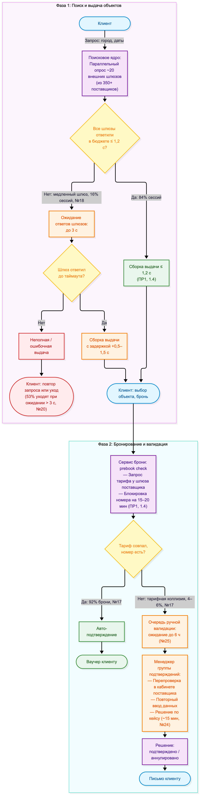
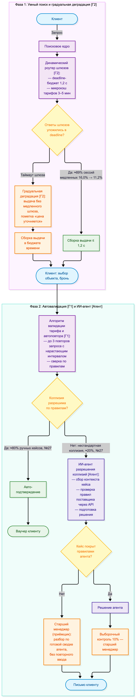
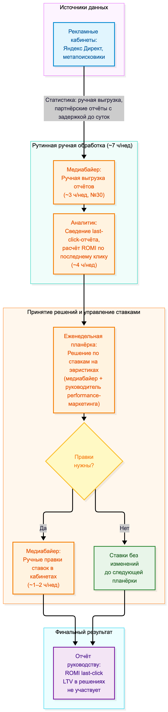
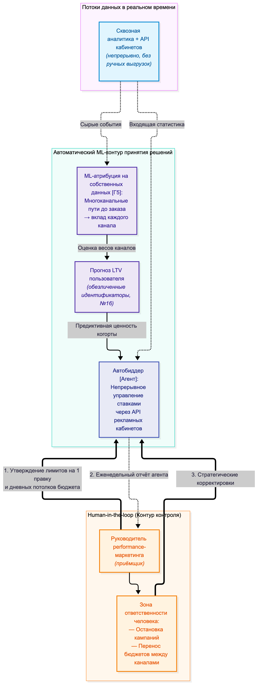

# Практическая работа №3 — Процессы под гипотезы

---

## Краткая версия паспорта

1. **Бизнес:** Группа Островок (ООО «Тревелтек») — российская travel-tech компания: B2C-платформа бронирования отелей, B2B-дистрибуция (Островок.b2b), корпоративные командировки, рекламное направление (AdTech).
2. **Масштаб:** совокупная выручка операционных компаний группы за 2025 год — 10,86 млрд руб («Коммерсантъ»); 1 % выручки = 108,6 млн руб. Собственная разработка: 358 штатных инженеров, 300+ микросервисов, 1 500 серверов, поисковое ядро 30 000 RPS (ПР1, раздел 1.5).
3. **Гипотезы в работе (ПР2, раздел 5):** Г2 — устойчивость поисковой выдачи к сбоям внешних поставщиков (ранг 1 по формуле), Г1 — автоматизация подтверждения брони (стратегический критерий ИТизации), Г5 — ML-атрибуция платного маркетинга (разрыв с коридором: убыток B2C-оператора при маркетинге ~30 % выручки). Принятые результаты: +0,85 % + 0,85 % выручки и −4,5 % статьи маркетинга.
4. **Процессы в перепроектирование:** А — «Обработка поискового запроса и подтверждение брони» (шаги 1–2 пути заказа, обслуживает Г2 и Г1); Б — «Планирование и закупка платного маркетинга» (обслуживает Г5). В каждом процессе определено место ИИ-агента: назван приёмщик результата из людей, посчитана цена приёмки.
5. **Ограничения:** только открытые данные. Для каждого шага процессов — замер или способ съёма (система, период, владелец данных); величины без замера внесены в реестр допущений №24–33 (сквозная нумерация с ПР1–ПР2).

**Опирается на:** гипотезы Г2, Г1, Г5, взятые в работу в ПР2 (карточки, пороги, допущения №17–23); путь «от заказа до денег» из ПР1 (раздел 1.4); отраслевой коридор курса.

---

## 1. Выбор процессов и связь с ПР2

Правило выбора: процесс берётся в перепроектирование только если через него проходит хотя бы одна гипотеза из состава «в работу» (ПР2, раздел 5) — каким бы интересным процесс ни казался сам по себе. Г1 и Г2 лежат на шагах 1–2 пути «от заказа до денег» (ПР1, раздел 1.4) и реализуются в одном сквозном процессе «от поискового запроса до подтверждения брони»: их нельзя перепроектировать по отдельности, не разорвав поток заказа. Г5 живёт в другом контуре — она меняет не клиентский путь, а управленческий цикл расходования маркетингового бюджета (3,258 млрд руб/год, допущение №16), поэтому для неё взят второй процесс.

| Процесс | Гипотезы ПР2 «в работу» | Механика гипотезы, реализуемая процессом | Что меняется в процессе |
| :--- | :--- | :--- | :--- |
| **А. Обработка поискового запроса и подтверждение брони** (шаги 1–2 пути, ПР1 1.4) | **Г2** (ранг 1), **Г1** (ИТизация) | Г2: динамический роутинг запросов к 350+ поставщикам, микрокэш тарифов, градуальная деградация. Г1: алгоритм валидации тарифов и автоповтора вместо ручного разрешения коллизий | Схема опроса внешних шлюзов, обработка таймаутов, ветвление «автоподтверждение / ручная валидация», место ИИ-агента |
| **Б. Планирование и закупка платного маркетинга** | **Г5** (стратегический критерий) | ML-многоканальная атрибуция с прогнозом LTV вместо last-click и ручных ставок; автобиддер через API рекламных кабинетов | Цикл «данные → решение → правка ставок», место ИИ-агента |

Что в перепроектирование не взято и почему:

* **Процесс миграций и внутренних коммуникаций** (жёлтая зона «Связь» ПР1) не обслуживает ни одну гипотезу из «в работу»: в ПР2 финансовая гипотеза на этом контуре не формулировалась. Обещание ПР2 («перенесена на этап анализа внутренних сервисов») закрывается разделом 5 настоящей работы: базовые значения четырёх DORA-показателей внутреннего контура разработки фиксируются там же — но процесс в перепроектирование не входит, потому что обслуживать нечего.
* **Процессы гипотез Г3 и Г4** (self-service кабинет AdTech, триггерные коммуникации) не проектируются: обе гипотезы лежат в резерве ПР2, их процессы будут перепроектированы, когда гипотезы перейдут в работу.

*Примечание:* ключевое условие работы — замер до изменения — выполнено для обоих процессов: каждый шаг таблиц потерь (разделы 2.2 и 3.2) снабжён замером или способом съёма, а исходные точки эффекта в разделе 7 берутся из этих же величин.

---

## 2. Процесс А: обработка поискового запроса и подтверждение брони

### 2.1. Процесс до изменения

Запись процесса — потоковая нотация, равнозначная BPMN: шаги в скобках, роли подписаны, ромбы — точки ветвления, порядок сверху вниз.

Шаги 3–4 пути (оплата, генерация ваучера после фиксации в PMS) в перепроектирование не входят: слабые шаги пути — 1 и 2 (ПР1, 1.4), и именно через них проходят Г1 и Г2. Шаг 3 (платёжный шлюз) — единственное место мгновенной остановки денег (21 млн руб/день, №13), но гипотез на него нет: он остаётся под текущим мониторингом.

### 2.2. Таблица потерь (до изменения)

| Шаг | Роль | Время работы | Время ожидания | В чём потеря | Источник замера / способ съёма |
| :--- | :--- | :--- | :--- | :--- | :--- |
| Опрос шлюзов и сборка выдачи | Поисковое ядро (система) | 0,3–0,5 с на сборку | до 3 с на 16 % сессий (№18) | Ожидание медленных внешних шлюзов деградирует выдачу целиком; 53 % пользователей уходят при ожидании > 3 с (№20); эластичность +500 мс → −4–6 % конверсии (№9) | Замер: логи поискового кластера и мониторинг таймаутов API (Grafana/VictoriaMetrics); период — 3 месяца; владелец данных — руководитель группы интеграций |
| Выбор объекта и бронь | Клиент | ~2 мин | — | Вне оптимизации: действия клиента не потеря процесса | Веб-аналитика; период — квартал |
| Prebook check тарифа | Сервис бронирования (система) | 1–2 с | до 3 с при ретраях | Повторные запросы к шлюзу при таймаутах | Замер: логи API-шлюзов; период — 3 месяца; владелец — руководитель группы интеграций |
| Ручная валидация коллизии | Менеджер группы подтверждений | ~15 мин/кейс (№24) | **до 6 ч в очереди (№25)** | Ожидание в очереди, повторный ввод данных из кабинета поставщика; клиент за часы ожидания уходит к другому агрегатору (инкрементальность спасённых заказов 0,50, №20) | Способ съёма: трекер заявок подтверждения — время заявки в статусе «в ручной проверке»; период — квартал; владелец данных — руководитель группы подтверждений |
| Уведомление клиента | Система нотификаций | < 1 мин | — | Вне оптимизации | Логи ESP; период — квартал |

Основная потеря — во времени ожидания, а не во времени работы. Очередь ручной валидации (до 6 ч) на два порядка дороже 15 минут работы менеджера, ожидание внешних шлюзов (до 3 с) — дороже сборки выдачи (0,3–0,5 с). Оптимизировать «работу» бессмысленно — убирать нужно ожидание: это и определяет логику изменений ниже.

### 2.3. Процесс после изменения

Изменения подсвечены: **[Г2]**, **[Г1]**, **[Агент]**.

Каждое изменение подписано — какую потерю убирает и какую гипотезу обслуживает:

| Изменение | Какую потерю убирает | Какую гипотезу обслуживает |
| :--- | :--- | :--- |
| Динамический роутинг шлюзов с deadline-бюджетом времени | Ожидание до 3 с на 16 % сессий: медленный шлюз больше не блокирует выдачу целиком | Г2 |
| Микрокэш тарифов 3–5 мин + градуальная деградация | Повторные запросы и неполные выдачи при таймаутах: клиент получает результат вместо ошибки сессии | Г2 |
| Алгоритм валидации и автоповтора (до 3 повторов) | Очередь до 6 ч: стандартная коллизия разрешается за секунды без человека | Г1 |
| ИИ-агент разрешения коллизий | Ручной труд и повторный ввод данных (~20 тыс часов/год, №26): агент собирает контекст кейса сам, менеджеру достаётся готовая сводка | Г1 (инструментальная часть) |
| Выборочный контроль 10 % вместо разбора каждого кейса | Контрольная нагрузка на старшего менеджера при сохранении качества решений | Г1 (контур качества) |

---

## 3. Процесс Б: планирование и закупка платного маркетинга

### 3.1. Процесс до изменения

Квартальный цикл планирования бюджета (распределение между каналами) идёт поверх недельного цикла ставок и здесь не меняется — стратегическое распределение бюджета остаётся решением человека и после перепроектирования (раздел 6.2).

### 3.2. Таблица потерь (до изменения)

| Шаг | Роль | Время работы | Время ожидания | В чём потеря | Источник замера / способ съёма |
| :--- | :--- | :--- | :--- | :--- | :--- |
| Выгрузка статистики из кабинетов | Медиабайер | ~3 ч/нед | до суток (задержка отчётов кабинетов) | Решения по данным недельной давности при бюджете 271,5 млн руб/мес (3,258 млрд / 12, №16) | Способ съёма: журналы рекламных кабинетов — время последней правки ставки по каждой кампании; период — квартал; владелец данных — руководитель performance-маркетинга |
| Сведение last-click отчёта | Аналитик маркетинга | ~4 ч/нед | до 2 дней к концу недели | Last-click завышает вклад брендовых каналов; LTV пользователя не виден: переплата за недоинкрементальные брендовые клики ≈ 4,5 % статьи (№21) | Расчёт №21 (структура трафика × NBER WP 20171); сверка — семантический отчёт рекламных кабинетов |
| Планёрка и решение по ставкам | Медиабайер + руководитель performance | ~1 ч/нед | до 5–7 дней от данных до правки (№30) | Цикл «правка раз в неделю» против аукциона, который живёт сутками; эвристики без сквозных данных | Способ съёма: журналы кабинетов — история ставок; период — квартал; владелец — руководитель performance-маркетинга |
| Ручные правки ставок | Медиабайер | ~1–2 ч/нед | — | Частота и охват правок ограничены одним человеком | Журналы кабинетов; период — квартал |

И здесь основная потеря не в часах работы, а в ожидании и в качестве решений: ручной труд команды — десятки часов в неделю, а переплата за устаревшую модель атрибуции — 146,6 млн руб/год (4,5 % статьи маркетинга, №21). Дешёвое ручное звено стоит дороже дорогой автоматизации.

### 3.3. Процесс после изменения

Изменения подсвечены: **[Г5]**, **[Агент]**.

| Изменение | Какую потерю убирает | Какую гипотезу обслуживает |
| :--- | :--- | :--- |
| ML-многоканальная атрибуция вместо last-click | Переплату за недоинкрементальный брендовый трафик и каннибализацию органики — 4,5 % статьи (146,6 млн руб/год, №21) | Г5 |
| Прогноз LTV в решениях по ставкам | Закупку «дешёвых, но нулевых по LTV» заказов: ставки считаются по вкладу канала в валовую прибыль, а не по последнему клику | Г5 |
| Автобиддер с лимитами вместо недельного цикла | Ожидание 5–7 дней от данных до правки (№30): реакция на аукцион — часы; плюс ~8–9 ч/нед ручной выгрузки и правок | Г5 |

---

## 4. Практики ITIL 4, которые затрагиваются

Берутся только практики, которые действительно меняются в процессах А и Б; у каждой — условие, по которому она попала в работу, и конкретное место изменения. Практики, не затронутые ни одним изменением, не перечисляются.

| Практика ITIL 4 | Условие попадания | Процесс | Что именно меняется |
| :--- | :--- | :---: | :--- |
| Service level management | Гипотеза меняет обещание клиенту / внутреннему заказчику | А | Новые целевые значения сервиса: доля сессий с задержкой > 1,5 с ≤ 11,2 % (порог Г2) и успешность подтверждения ≥ 94 % (порог Г1); фиксируются как внутренние SLA сервиса поиска и подтверждений, для B2B-канала — в соглашениях с агентствами |
| Monitoring and event management | Сейчас о сбое узнают от клиента | А | События таймаутов и деградаций ловятся до жалобы (Grafana/VictoriaMetrics, ПР1 1.5): правило «порог таймаутов шлюза → автодеградация [Г2] → алерт дежурному»; целевая метрика — доля сбоев, замеченных клиентом, снижается |
| Incident management | Потери идут через сбои | А | Таймаут шлюза перестаёт быть клиентским инцидентом: градуальная деградация [Г2] отрабатывает сбой автоматически; классификация инцидентов пересматривается — приоритет «деградации выдачи» считается от цены задержки (21 млн руб/день притока, №13) |
| Problem management | Повторяющиеся сбои и обращения | А | Топ повторяющихся тарифных коллизий по каждому поставщику разбирается как известная ошибка: правка маппинга тарифов снимает сам источник ручных кейсов, а не ускоряет их разбор |
| Supplier management | Часть шагов держит внешний поставщик | А | Роутинг [Г2] опирается на фактический (а не заявленный) SLA шлюзов; лимиты автоповторов [Г1] согласуются с поставщиками; хронически медленные шлюзы — кандидат на пересмотр условий или исключение из роутинга |
| Change enablement | Узкое место — согласование и выкатка изменений | А, Б | Для А: выкатка роутера и алгоритма валидации — фиче-флагами и A/B-тестом с готовым откатом (включение/выключение флага — без релиза). Для Б: правки ставок из ручных изменений становятся непрерывными автоматическими — вводятся лимиты агента, журнал изменений и процедура отката |

Service request management не берётся: ни один из двух процессов не начинается с запроса на обслуживание — бронирование на сайте и недельный цикл маркетинга к практике запросов не относятся.

---

## 5. Поток поставки глазами DevOps (DORA)

Гипотезы Г1 и Г2 — изменения в цифровом продукте (поисковое ядро, сервис подтверждений), поэтому пункт не пропускается: собственная разработка у бизнеса есть (358 инженеров, 300+ микросервисов, ПР1). DORA-метрики у Островка внедрены (ПР1, 1.5: критичные инциденты снижены на 80 % год к году), но точные текущие значения публично не раскрываются — за базовые приняты качественные уровни из публичного кейса с обязательным съёмом по внутренним системам (допущение №29).

| Показатель DORA | Базовое значение (№29) | Как бы сняли точно | Как меняется от Г1–Г2 |
| :--- | :--- | :--- | :--- |
| Частота выкаток | Ежедневно и чаще (контур поиска) | GitLab CI: количество production-деплоев контура поиска; период — 6 месяцев; владелец — руководитель релиз-инженерии | Роутер и алгоритм валидации выкатываются фиче-флагами в общем потоке — частота выкаток не падает |
| Время от коммита до прода | < 1 суток | GitLab CI: медиана от merge до production; период — 6 месяцев | Фиче-флаг отделяет выкатку от включения: само включение — минуты, без релизного цикла |
| Доля неудачных изменений (CFR) | ~15 % | Релиз-журнал: доля деплоев, потребовавших отката или горячего фикса; период — 6 месяцев | Неудачное изменение = выключение флага без отката релиза; A/B и теневой режим алгоритма валидации снижают CFR контура |
| Время восстановления (MTTR) | < 1 ч | Журнал инцидентов дежурной смены; период — 6 месяцев | Градуальная деградация [Г2] переводит сбой внешнего шлюза из инцидента выдачи в штатное событие: MTTR класса «внешний поставщик» стремится к нулю |

Г5 (автобиддер) продуктовый код не меняет — она переносит решения из еженедельного цикла людей в непрерывный контур изменений маркетинга. Для этого контура действует своя «поставка»: каждая правка ставок журналируется, лимиты и откат заданы заранее (раздел 4, change enablement), поэтому частота изменений перестаёт быть ограничением качества решений.

---

## 6. Место агента в новых процессах

В обоих процессах агент занимает место рутинного звена, а не лица, принимающего решение: в схеме агент стоит там, где есть повторяющаяся работа с проверяемым результатом, а не там, где красиво. У каждого агента есть названный приёмщик результата из людей. Разбор по четырём вопросам: какие шаги уходят агенту, что агент видит и чем действует, кто принимает результат и сколько это стоит, что агенту не отдаётся и почему.

### 6.1. Агент процесса А — «Разбор тарифных коллизий»

LLM-агент с базой правил поверх API, появляется на месте ручной валидации (подсвечен **[Агент]** в схеме 2.3).

| Вопрос | Ответ |
| :--- | :--- |
| **Какие шаги уходят агенту** | Критерий отбора — повторяющаяся работа с текстом и данными, где есть проверяемый результат: коллизии повторяются ~17 тыс раз в год (№26–27), а результат решения проверяется по фактическому тарифу и базе правил поставщика — поэтому именно эти шаги отданы агенту. Агент принимает кейс, который алгоритм [Г1] не смог разрешить правилами; собирает контекст (история тарифа за 72 часа, правила поставщика, статусы номеров, лог попыток); проверяет тариф через API поставщика; готовит проект решения по базе правил; оформляет результат в сервисе бронирования; эскалирует непокрытые кейсы старшему менеджеру с готовой сводкой |
| **Что видит и чем действует** | Видит: обезличенную карточку брони (id заказа, тарифы, правила поставщика, статусы), базу правил поставщиков. Не видит: ФИО, контактов, паспортных и платёжных данных гостей. Действует: Partner API v3 поставщика, внутренний сервис подтверждений, база правил — без прямого доступа к биллингу |
| **Кто принимает и сколько стоит** | Приёмщик результата — старший менеджер группы подтверждений: выборочный контроль 10 % авто-решений агента и 100 % эскалаций; письмо клиенту по нестандартным кейсам отправляет человек. Стоимость: разработка — внутри пилота Г1 (7,63 млн руб, ПР2, таблица 4.2); эксплуатация ≈ 0,4 млн руб/мес — инфраструктура ~0,15 млн, токены и обслуживание базы правил — остальное (№28). Цена приёмки: ~7 тыс эскалаций (~10 мин разбор по готовой сводке) и ~1 тыс контрольных проверок (~4 мин) ≈ 1,2 тыс ч/год ≈ ~1,2 млн руб/год ФОТ-стоимости старшего менеджера (№31–32); сумма включена в операционные затраты нового процесса (раздел 7) — без неё экономия времени завышена |
| **Что не отдаётся и почему** | Персональные и платёжные данные гостей — в контур агента не передаются, обработка только в обезличенном виде (152-ФЗ); компенсации, аннуляции и решения вне базы правил — решения с правовыми последствиями перед клиентом, за них отвечает человек; изменение условий договора с поставщиком — ошибка здесь обнаруживается не сразу, а через биллинг и партнёрские отношения, когда цена ошибки уже накоплена |

### 6.2. Агент процесса Б — «Управление ставками» (автобиддер)

Автоматизированный агент поверх API рекламных кабинетов (подсвечен **[Агент]** в схеме 3.3).

| Вопрос | Ответ |
| :--- | :--- |
| **Какие шаги уходят агенту** | Критерий отбора тот же — повторяющаяся работа с данными, где есть проверяемый результат: пересчёт ставок происходит непрерывно, а результат проверяется по журналу правок и целевому CAC/LTV — поэтому эти шаги отданы агенту. Агент непрерывно собирает статистику из кабинетов и сквозной аналитики; пересчитывает многоканальную атрибуцию и прогноз LTV; рассчитывает ставки по целевому соотношению CAC/LTV; правит ставки через API в пределах лимитов; формирует еженедельный отчёт для приёмщика |
| **Что видит и чем действует** | Видит: статистику рекламных кабинетов, сквозную аналитику на обезличенных идентификаторах, параметры LTV-модели, собственные лимиты. Действует: API рекламных кабинетов — только изменение ставок и бюджетов в пределах дневного потолка канала |
| **Кто принимает и сколько стоит** | Приёмщик результата — руководитель performance-маркетинга: утверждает лимиты изменений и бюджетные коридоры, получает отчёт агента; остановку кампании и перенос бюджета между каналами решает человек. Стоимость: пилот 13,82 млн руб (ПР2, таблица 4.2); эксплуатация ≈ 0,2 млн руб/мес (серверы по ставкам №22 ПР2 + сопровождение LTV-модели). Цена приёмки: еженедельный отчёт агента (~45 мин/нед), ежемесячный пересмотр лимитов и коридоров (~1 ч/мес), выборочный контроль журнала правок (~30 мин/нед) — суммарно ~80 ч/год ≈ ~0,12 млн руб/год (№32); включена в экономику раздела 7 |
| **Что не отдаётся и почему** | Персональные данные — в кабинеты и агенту уходят только обезличенные идентификаторы (152-ФЗ); договоры и платёжные реквизиты рекламных площадок — решения с правовыми последствиями, их проверяет юрист, а не агент; стратегический бюджет и вход в новый канал — последствия растянуты на кварталы и сразу не проверяются; полный останов кампании — выпадение объёма проявляется днями, когда отката по лимитам уже недостаточно |

### 6.3. Приёмка результата и персональные данные

Общая конструкция одинаковая: агент готовит решение, человек его принимает и отвечает перед бизнесом. У агента процесса А приёмщик — старший менеджер группы подтверждений (10 % выборочно, 100 % эскалации), у агента процесса Б — руководитель performance-маркетинга (лимиты, коридоры, отчёт). Финальные клиентские коммуникации по нестандартным кейсам и все решения о деньгах сверх лимитов остаются за людьми.

Приёмка результата агента — сама по себе работа: у неё есть своё время и своя стоимость, и если её не посчитать, экономия от агента завышается. Поэтому приёмка посчитана в обоих процессах:

| Процесс | Приёмщик и объём приёмки | Цена приёмки |
| :--- | :--- | :--- |
| А — разбор коллизий | 100 % эскалаций (~7 тыс/год, ~10 мин разбор по готовой сводке агента) + выборочный контроль 10 % авто-решений (~1 тыс/год, ~4 мин) | ~1,2 тыс ч/год ≈ ~1,2 млн руб/год ФОТ-стоимости (№31–32) |
| Б — управление ставками | Еженедельный отчёт агента (~45 мин/нед), ежемесячный пересмотр лимитов и коридоров (~1 ч/мес), выборочный контроль журнала правок (~30 мин/нед) | ~80 ч/год ≈ ~0,12 млн руб/год (№32) |

Обе суммы входят в операционные затраты новых процессов и учтены в разделе 7: полный операционный контур агента А — ~6,0 млн руб/год (эксплуатация 4,8 + приёмка 1,2) против 91,9 млн руб прироста выручки Г1; контур Б — ~2,5 млн руб/год (эксплуатация 2,4 + приёмка 0,12) против 146,6 млн руб экономии статьи маркетинга. Пороги выполняются с запасом, но уже с оплаченной приёмкой, а не в предположении бесплатного контроля.

Персональные данные: оба агента работают только с обезличенными идентификаторами заказов и пользователей; связывание «заказ → гость» происходит в сервисе бронирования после того, как решение агента принято и принято человеком. Паспортные, контактные и платёжные данные в контур агентов не передаются (152-ФЗ); все действия агентов журналируются и доступны приёмщику результата.

---

## 7. Эффект и trade-off

### 7.1. Эффект от исходной точки на принятый результат

Исходные точки — те же замеры и допущения, что в таблицах потерь (разделы 2.2, 3.2); принятые результаты — пороги карточек ПР2. Эффект считается от исходной точки процесса и на принятый результат, а не на объём сделанной работы:

| Показатель | Исходная точка (замер / допущение) | Принятый результат (порог ПР2) | Механика изменения | Эффект |
| :--- | :--- | :--- | :--- | :--- |
| Доля медленных сессий выдачи | 16,0 % (№18) | ≤ 11,2 % (−30 %) | Роутинг + микрокэш + градуальная деградация [Г2] | +1,0 % к Look-to-Book → **+91,9 млн руб = +0,85 % выручки** |
| Успешность подтверждения с первой попытки | 92,0 % (№17) | ≥ 94,0 % (+2,0 п.п.) | Алгоритм валидации и автоповтора [Г1] × инкрементальность 0,50 (№20) | **+91,9 млн руб = +0,85 % выручки** |
| Средний CAC платного привлечения | 1 950 руб (№16) | −4,5 % статьи маркетинга (№21) | ML-атрибуция + LTV + автобиддер [Г5] | **−146,6 млн руб затрат/год = 1,35 % выручки** |

Сверка с коридором: Г1 и Г2 — по 0,85 % выручки (коридор 0,3–2,0 %), Г5 — 4,5 % статьи (коридор 2,0–10,0 % статьи). Совокупный результат совпадает с ПР2 (+4,29 % выручки и 1,35 % по затратной строке) по построению: перепроектирование процессов — способ достижения порогов гипотез, а не новый источник эффекта, поэтому двойного счёта с ПР2 нет.

Эффект — на принятый результат, затраты — на весь объём работы. Если агент подготовил десять вариантов, а принят из них один, результат — один, а оплачены все десять — поэтому объём работы агентов в результат не засчитывается. Затраты посчитаны на весь объём: эксплуатация агента А (№28) — на все ~17 тыс агент-кейсов в год, включая кейсы, которые приёмка завернёт; инфраструктура и сопровождение автобиддера (№22 ПР2) — на все правки ставок, включая откаченные лимитами или приёмщиком (№33: ориентировочно 600–1 200 правок в месяц). В результат идёт только принятое: по процессу А — подтверждения, прошедшие приёмку (авто-решения под выборочным контролем и эскалации, принятые старшим менеджером) и не оспоренные клиентом: метрика порога Г1 «успешность подтверждения с первой попытки ≥ 94 %» по построению считается на принятый результат; по процессу Б — подтверждённое на 3-месячном пилоте снижение CAC на 4,5 %, а не число внесённых правок. Считать эффект по объёму работы (число разобранных кейсов или правок ставок) значило бы завысить его кратно.

Сопутствующий эффект, не включаемый в пороги: ручная валидация ~85 тыс кейсов/год ≈ 21 тыс часов (№26) заменяется так: ~68 тыс кейсов разрешает алгоритм [Г1] без человека, ~17 тыс уходят агенту; агент покрывает правилами ~10 тыс (№31), приёмщику достаются ~7 тыс эскалаций и ~1 тыс выборочных проверок — суммарно ~1,2 тыс ч/год человеческого времени против 21 тыс ч. Высвобождается порядка 11 ставок рутинной работы; взамен появляется ~0,7 ставки приёмки старшего менеджера, чей час дороже (№32), — цена приёмки показана отдельной строкой и в экономию не прячется, иначе высвобождение завышалось бы, а стоимость нового процесса занижалась. Экономия по ФОТ поддержки в денежный эффект не добавляется: это другая строка P&L, и смешение её с выручечным эффектом Г1 дало бы двойной счёт; величина зафиксирована как резерв качества сервиса.

### 7.2. Что ухудшается и чем за это платим

| Ухудшение | Тип | Механизм | Чем удерживаем |
| :--- | :--- | :--- | :--- |
| Овербукинг на кэшированных тарифах: рост ошибок доступности до +0,1 п.п. | Устойчивое | Кэш 3–5 мин устаревает: между обновлением кэша и оплатой номер успевает занять другой клиент [Г2] | Повторный prebook-чек перед списанием для кэшированных тарифов; компенсационная механика в правилах аннуляции |
| Рост нагрузки на API поставщиков от автоповторов | Устойчивое | 3-кратный автоповтор [Г1] на потоке коллизий увеличивает число запросов к шлюзам: риск троттлинга и охлаждения партнёрских отношений | Лимиты повторов на шлюз согласуются в рамках supplier management; повторы только на валидационных запросах, не на бронировании |
| Ошибки агента на редких кейсах | Устойчивое | Агент ошибается «уверенно» там, где человек сомневался бы: поток стандартных кейсов шире класса правил, на котором агент учился | Выборочный контроль 10 % и 100 % эскалаций; компенсации и аннуляции — только человек |
| Дрейф эффективности автобиддера | Устойчивое | Аукцион — игра с ответной реакцией: конкуренты адаптируются, часть экономии 4,5 % со временем выветривается [Г5] | Переобучение модели атрибуции по расписанию; порог Г5 проверяется на 3-месячном пилоте, а не постфактум |
| Полнота выдачи на деградировавших сессиях | Устойчивое, малое | Выдача без медленного шлюза — часть объектов клиент не видит [Г2] | Пометка «цена уточняется» и доуточняющая выдача после ответа шлюза |
| Отладка автобиддера и LTV-модели на переводе каналов | Переходная просадка (~2 мес) | На переводе каналов ставки временно неоптимальны | Поэтапный перевод с 25 % бюджета; риск-резерв 8,15 млн руб (ПР2, таблица 4.2) |

Пять устойчивых ухудшений названы с механизмами и отделяются от разовой переходной просадки: первые пять не исчезают после пилота, поэтому под каждую заложен удерживающий механизм; шестое — цена входа, которая спадает после стабилизации.

Все ухудшения ложатся на три оси обмена, и по каждой ось прошла не в одну сторону. Скорость против контроля: подтверждение за секунды куплено переходом от стопроцентной ручной проверки к выборочным 10 % — часть ошибок агента обнаруживается не сразу, а по жалобе клиента, поэтому доля оспариваний и компенсаций выводится в еженедельный мониторинг приёмщика. Экономия против устойчивости: экономия 146,6 млн руб держится на устойчивости LTV-модели, API кабинетов и отсутствии сильного ответа конкурентов — часть её выветривается с дрейфом автобиддера, а кэш тарифов покупает скорость ценой овербукинга. Автоматизация против гибкости в нетиповых случаях: правила [Г1] и базы правил агента покрывают типовое, нестандартные кейсы (акции поставщиков, групповые брони) намеренно оставлены человеку — гибкость сохранена ценой ~7 тыс эскалаций в год. Ни по одной из трёх осей «только улучшения» нет — все пять плат названы и удерживаются механизмами, а не надеждой, что пилот всё сгладит.

---

## 8. Реестр допущений (пополненный, сквозная нумерация с ПР1–ПР2)

Нумерация сквозная: №1–13 — ПР1, №14–16 — дополнения ПР1, №17–23 — ПР2, №24–33 — настоящая работа. Все величины без публичного замера внесены сюда.

| № | Допущение | Откуда взята оценка (методика) | Уверенность | Что проверит и уточнит |
| :-: | :--- | :--- | :---: | :--- |
| **24** *(ПР3)* | Время ручного разбора тарифной коллизии ~15 мин/кейс | Норматив группы подтверждений на стандартный кейс (перепроверка в кабинете поставщика + фиксация решения); диапазон 10–20 мин | Средняя (0,5) | Трекер заявок подтверждения: время заявки в статусе «в ручной проверке» за квартал |
| **25** *(ПР3)* | Очередь ручной валидации — до 6 ч в пиковые часы | Заявки обрабатываются сменами поддержки в порядке поступления; в пик (вечера, распродажи) накопление до начала смены; диапазон 2–6 ч | Средняя (0,5) | Трекер: распределение времени заявки в очереди за квартал; владелец — руководитель группы подтверждений |
| **26** *(ПР3)* | Поток заказов через шаг подтверждения ~1,7 млн/год; нагрузка ручной валидации ~85 тыс кейсов ≈ 21 тыс часов/год | Расчёт: B2C-заказы 1,58 млн/год (№16) + B2B ~0,1–0,15 млн/год; ручная валидация 4–6 % заказов (№17), середина 5 % → ~85 тыс кейсов × 15 мин (№24) ≈ 21 тыс часов ≈ 12 ставок (1 800 ч/год) | Низкая (0,3) | Биллинг (число заказов) + трекер заявок (доля ручных) за квартал |
| **27** *(ПР3)* | Алгоритм [Г1] разрешает ~80 % ручных коллизий; агенту и менеджеру достаётся ~20 % | Стандартные коллизии (изменение цены, временная недоступность номера) доминируют над нестандартными (акции, групповые брони) — правило Парето | Низкая (0,3) | Реплей исторических кейсов на алгоритме (логи за 12 месяцев) до старта разработки; затем пилот Г1 |
| **28** *(ПР3)* | Эксплуатация агента процесса А ≈ 0,4 млн руб/мес | Расчёт: ~85 тыс кейсов/год × 20 % (№27) ≈ 17 тыс агент-кейсов/год; инфраструктура 5 серверов × 0,03 млн (№22 ПР2) = 0,15 млн/мес; токены и обслуживание базы правил — остаток | Средняя (0,5) | Коммерческие предложения LLM-провайдеров на этапе закупки пилота Г1 |
| **29** *(ПР3)* | Базовые DORA-значения контура поиска: выкатки ежедневно и чаще; lead time < 1 сут; CFR ~15 %; MTTR < 1 ч | Качественный уровень из публичного кейса Островка (ПР1, 1.5: DORA внедрены, критичные инциденты −80 % год к году); точные значения не публикуются | Средняя (0,5) | GitLab CI и журнал инцидентов за 6 месяцев до пилота Г1/Г2; владелец — руководитель релиз-инженерии |
| **30** *(ПР3)* | Цикл «данные → правка ставок» в процессе Б — 5–7 дней | Наблюдение недельного цикла: выгрузка (пн) → сведение (вт–ср) → планёрка (чт) → правки (пт); аукцион при этом меняется сутками | Низкая (0,3) | Журналы рекламных кабинетов: история изменения ставок за квартал; владелец — руководитель performance-маркетинга |
| **31** *(ПР3)* | Агент А покрывает своей базой правил ~60 % поступающих к нему кейсов (~10 тыс из ~17 тыс); ~40 % (~7 тыс) эскалируются старшему менеджеру | Класс кейсов после алгоритма [Г1] неоднороден (акции поставщиков, групповые брони, частичные возвраты): агент с доступом к API и истории тарифа шире алгоритма, но класс не исчерпывает — правило Парето на сдвинутом классе | Низкая (0,3) | Пилот Г1: реплей исторических кейсов на агенте до старта; затем доля эскалаций в трекере за квартал |
| **32** *(ПР3)* | Стоимость часа приёмщика: старший менеджер группы подтверждений ~1 000 руб/ч; руководитель performance-маркетинга ~1 500 руб/ч | Полная стоимость работодателя (оклад + страховые взносы + накладные) при ~165 рабочих часах в месяц; диапазоны 800–1 200 и 1 200–1 800 руб/ч соответственно | Средняя (0,5) | ФОТ-план группы подтверждений и performance-маркетинга |
| **33** *(ПР3)* | Автобиддер вносит ориентировочно 20–40 правок ставок в день (600–1 200/мес); часть правок откачивается лимитами или приёмщиком | Число активных кампаний × частота пересчёта ставок; объём правок — это объём работы: он целиком сидит в затратах, в результат идёт только принятый эффект (CAC) | Низкая (0,3) | Журнал изменений автобиддера за 3-месячный пилот; владелец — руководитель performance-маркетинга |

---

## 9. Список источников

1. Практическая работа №1 «Бизнес и его ИТ» (Группа «Островок») — паспорт, путь «от заказа до денег» (раздел 1.4), ИТ-функция и инфраструктура (раздел 1.5), реестр допущений №1–16.
2. Практическая работа №2 «Гипотезы роста выручки» — карточки гипотез Г1–Г5, таблица эффектов (раздел 3.2), разложение стоимостей пилотов (таблица 4.2), состав «в работу» (раздел 5), реестр допущений №17–23.
3. Отраслевой коридор целевых показателей курса «Управление ИТ на предприятии» (база 10,86 млрд руб; нормативы 0,3–2,0 % по выручке, 2,0–10,0 % по статье затрат).
4. Задание практической работы №3 «Процессы под гипотезы» (Notion курса).
5. ITIL 4 Foundation (AXELOS, 2019) — состав практик; в работе использованы только шесть меняющихся.
6. DORA, State of DevOps — определения четырёх показателей потока поставки: https://dora.dev/
7. Кейс Островка по DORA-метрикам, Хабр: https://habr.com/ru/companies/ostrovok/articles/1024148/
8. Google/SOASTA, исследование мобильной скорости (53 % пользователей покидают сайт при загрузке > 3 с): https://www.thinkwithgoogle.com/marketing-strategies/app-and-mobile/mobile-page-speed-new-industry-benchmarks/
9. Blake T., Nosko C., Tadelis S. «Consumer Heterogeneity and Paid Search Effectiveness» (NBER WP 20171) — недоинкрементальность брендовых кликов: https://www.nber.org/papers/w20171
10. Федеральный закон № 152-ФЗ «О персональных данных» — требования к обработке и обезличиванию: http://www.consultant.ru/document/cons_doc_LAW_61801/
11. Документация Partner API v3 (интеграция с шлюзами поставщиков, таймауты и повторные запросы): https://b2b.ostrovok.ru/blog/podklyuchajtes-k-novoj-versii-api-s-pomoshhyu-sdk/
